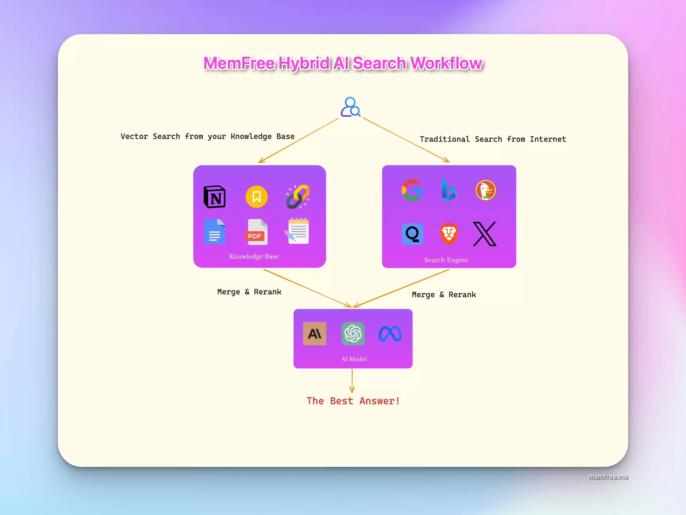

# MemGratuit

<h1 align="center"><a href="https://www.memfree.me">MemFree</a></h1>

**Anglais**\|[Chinois](./README.zh-CN.md)\|[Allemand](./README.de.md)\|[Français](./README.fr.md)\|[Espagnol](README.es.md)\|[japonais](./README.ja.md)

<h4 align="center">
  
  
  
    
  

</h4>

 

## Qu'est-ce que MemFree

MemFree is a <b>Moteur de recherche IA hybride</b>.

Avec MemFree, vous pouvez obtenir instantanément des réponses précises à partir de votre base de connaissances et de l'ensemble d'Internet.

MemFree est un<b>AI Page Generator</b>.

Memfree utilise le modèle d'IA le plus puissant - Claude 3.5 Sonnet et le framework front-end le plus populaire - React + Tailwind + Shadcn UI pour générer pour vous des pages d'interface utilisateur prêtes pour la production en quelques secondes.

[PageGen - AI Page Generator](https://pagegen.ai/).

## Qu'est-ce qui rend MemFree précieux ?

-   **Gestion efficace des connaissances**: MemFree élimine le besoin d'organisation manuelle des notes, des signets et des documents. Lorsque vous avez besoin d'informations, effectuez simplement une recherche dans MemFree pour trouver rapidement des réponses pertinentes, libérant ainsi votre mémoire et augmentant votre productivité.
-   **Résumés d'IA permettant de gagner du temps**: Au lieu de cliquer sur plusieurs résultats de recherche Google, MemFree utilise l'IA pour résumer instantanément le meilleur contenu des pages Web et de votre base de connaissances, ce qui vous fait gagner un temps précieux.
-   **Solution rentable**: Évitez les abonnements multiples à des services comme ChatGPT Plus, Claude Pro et Gemini Advanced. MemFree intègre leurs fonctionnalités, réduisant considérablement les coûts mensuels.
-   **Création de pages d'interface utilisateur 100 fois plus rapide**: Convertissez du texte ou des images en un code époustouflant et prêt pour la production en quelques secondes, Visualisez vos conceptions pendant que vous créez, Publiez vos pages en toute transparence.

## Fonctionnalités de recherche IA hybride MemFree

MemFree est équipé de fonctionnalités puissantes qui répondent à divers besoins de recherche et de productivité :

-   🤖**Multiple AI Models**: Intègre ChatGPT, Claude et Gemini pour diverses capacités d'IA.

-   🌐**Plusieurs moteurs de recherche pris en charge**: Fonctionne avec Google, Exa et Vector.

-   🖼️**Format d'entrée de recherche multiple**: Texte, images, fichiers et pages Web, en particulier, il prend en charge la recherche, la comparaison, le résumé et l'analyse multi-images.

-   📊**Plusieurs méthodes de présentation des résultats**: Textes, cartes mentales, images et vidéos.

-   📄**Compatibilité des formats de fichiers locaux**: Prend en charge les fichiers texte, PDF, Docx, PPTX et Markdown.

-   🔄**Synchronisation multi-appareils** : Enregistrez et synchronisez l'historique de recherche sur plusieurs appareils.

-   🌍**Prise en charge multilingue**: Disponible en anglais, chinois, allemand, français, espagnol, japonais et arabe.

-   🔗**Synchronisation des favoris Chrome**: Synchronisation et indexation en un clic.

-   📤**Partage des résultats**: partagez facilement vos résultats de recherche.

-   🔍**Recherche continue contextuelle** : Recherchez de manière transparente en fonction du contexte.

-   ⚙️**Décisions de recherche automatique sur le Web**: Détermine automatiquement quand effectuer des recherches sur Internet.

## Fonctionnalités du générateur d'interface utilisateur MemFree AI

-   **🖥️ Aperçu de l'interface utilisateur en temps réel** : Rendu et aperçu instantanés de l'interface utilisateur générée
-   **🔍 Recherche de contenu basée sur l'IA**: Enrichissez votre interface utilisateur avec du contenu pertinent grâce à notre fonctionnalité de recherche avancée par IA
-   **🖼 Génération d'interface utilisateur basée sur l'image** : Créez des composants et des pages d'interface utilisateur qui correspondent étroitement à vos images de référence
-   **📄 Génération fichier-page** : Transformez n'importe quel contenu de fichier en une page Web magnifiquement structurée avec l'analyse IA et le résumé IA
-   **✏️ Intégration de l'éditeur de code**: Modifiez et affinez votre code généré avec des capacités d'édition de type VSCode, complétées par la coloration syntaxique et la saisie semi-automatique.
-   **✨ Prise en charge des animations**: Créez des pages Web attrayantes avec des effets d'animation intégrés, donnant vie à votre contenu avec des transitions fluides et des éléments dynamiques
-   **⚛️ Intégration de l'interface utilisateur React + TailWind + Shadcn** : exploitez le code généré par l'IA à l'aide de la pile frontale la plus populaire : React, TailWind et Shadcn UI
-   **🚀 Publication de l'interface utilisateur en un clic**: Publiez et partagez votre interface utilisateur sur le Web instantanément en un seul clic
-   **📱 Code réactif et aperçu**: prévisualisez votre interface utilisateur sur différents appareils en temps réel, garantissant une adaptation parfaite à toutes les tailles d'écran
-   **🌓 Code et aperçu du mode sombre**: Générez sans effort du code d'interface utilisateur alimenté par l'IA avec prise en charge intégrée du mode sombre, vous permettant de prévisualiser instantanément les modes clair et sombre
-   **📸 Exportation de capture d'écran de l'interface utilisateur**: Exportez et partagez facilement vos conceptions d'interface utilisateur sous forme de captures d'écran de haute qualité pour une collaboration transparente
-   **🛠️ Correction intelligente des erreurs**: Bien que le modèle d'IA avancé de MemFree et les règles de code sophistiquées visent la perfection, des erreurs occasionnelles peuvent survenir. Notre fonction de correction intelligente des erreurs vous permet de résoudre instantanément tous les problèmes en un seul clic.

## Flux de travail de recherche IA hybride MemFree

## Journal des modifications

[Journal des modifications MemFree](https://www.memfree.me/changelog)

## Pile technologique

[Pile technologique complète de recherche d’IA hybride](https://www.memfree.me/blog/hybrid-ai-search-tech-stack)

## Déploiement en un clic

[Guide de déploiement MemFree en un clic](https://www.memfree.me/docs/one-click-deploy-ai-search)

### 1 Déployer le backend avec Zeabur

### 2 Déployer le frontend avec Vercel

<a href="https://vercel.com/new/clone?repository-url=https%3A%2F%2Fgithub.com%2Fmemfreeme%2Fmemfree&env=UPSTASH_REDIS_REST_URL,UPSTASH_REDIS_REST_TOKEN,OPENAI_API_KEY,MEMFREE_HOST,AUTH_SECRET,API_TOKEN&envDescription=https%3A%2F%2Fgithub.com%2Fmemfreeme%2Fmemfree%2Fblob%2Fmain%2Ffrontend%2Fenv-example&project-name=memfree&repository-name=memfree&demo-title=MemFree&demo-description=MemFree – Hybrid AI Search Engine&demo-url=https%3A%2F%2Fwww.memfree.me%2F&demo-image=https%3A%2F%2Fwww.memfree.me%2Fog.png&root-directory=frontend"></a>

### 3 Déployer le frontend avec Netlify

### 4 Déployer sur le chemin de fer

### 5 Backend de déploiement d'une seule commande avec Fly.io

-   [Une commande déploie MemFree Vector sur Fly.io](https://www.memfree.me/docs/deploy-memfree-fly-io)

### 6 Déployez MemFree sur les pages Cloudflare

-   [Comment migrer MemFree de Vercel vers Cloudflare - pages suivantes](https://www.memfree.me/blog/couldflare-next-on-page-edge)

## Installations auto-hébergées

### Conditions préalables

#### Bien installer

    curl -fsSL https://bun.sh/install | bash

> Erreur de chignon introuvable

Si vous obtenez une erreur relative à la commande bun introuvable. Découvrez le :[Documentation officielle du chignon](https://bun.sh/docs/installation#checking-installation)

#### Upstash Redis

Créez une base de données compatible Redis en quelques secondes :[Upstash Redis](https://upstash.com/docs/redis/overall/getstarted)

#### Clé API OpenAI

Obtenez une clé API OpenAI :[OpenAI](https://platform.openai.com)

#### Clé API du serveur

Obtenez une clé API Serper :[Serper](https://serper.dev/api-key)

### L'extrémité avant

    cd frontend

    bun i

    cp env-example .env

    # Add your OpenAI API Key, Upstash Redis URL, and Serper API Key to .env

    bun run dev

### Service vectoriel

    cd vector

    bun i

    cp env-example .env

    # Add your OpenAI API Key, Upstash Redis URL to .env

    bun run index.ts

## Contribuer

Voici comment vous pouvez contribuer :

-   [Ouvrir un problème](https://github.com/memfreeme/memfree/issues)si vous pensez avoir rencontré un bug.
-   Faire un[demande de tirage](https://github.com/memfreeme/memfree/pulls)pour ajouter de nouvelles fonctionnalités/apporter des améliorations à la qualité de vie/corriger des bugs.

## Merci à tous les contributeurs

 

## Aide et support

-   [Discorde MemFree](https://discord.com/invite/7QqyMSTaRq)

## Feuille de route

-   [Feuille de route MemFree](https://www.memfree.me/roadmap)

## Licence

MemFree est soutenu par[MemGratuit](https://www.memfree.me/)et sous licence[AVEC](https://github.com/memfreeme/memfree/blob/main/LICENSE).

## Propulsé par MemFree

-   [PageGen - AI Page Generator](https://pagegen.ai)
-   [MemFree - Recherche d'IA hybride](https://www.memfree.me)
-   [StorySnap - Transformez les images en histoires](https://www.snapstoryai.com)
-   [Aperçu de l'interface utilisateur React + Shadcn](https://reactshadcn.com)

## Histoire des étoiles

